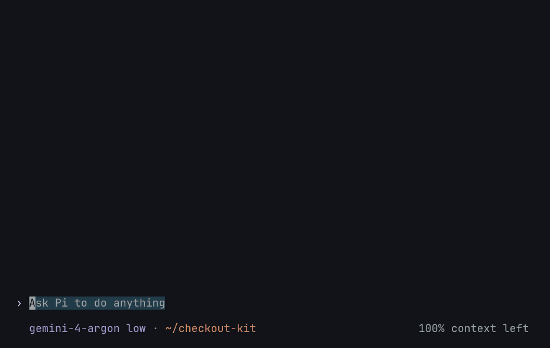
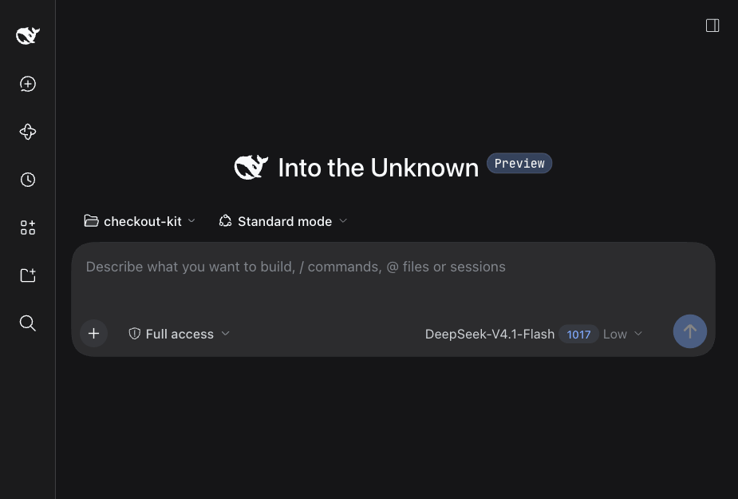

# Spine for Pi & DeepSeek Harness

[](https://arxiv.org/abs/2610.37224) [](https://www.npmjs.com/package/@spinejit/pi-spinejit) [](https://www.npmjs.com/package/@spinejit/dsh-spinejit) [](LICENSE)

English | [简体中文](README.zh-CN.md)

**Your agent's context, shaped like its task.**

Long-horizon tasks unfold as nested subtasks, yet an agent's context is a flat linear stream where finished explorations and dead ends pile up alongside unfinished work. **Spine** places execution under a persistent work tree (**`SpineTree`**, acting as the structural spine of long-horizon work): the agent opens subtasks with explicit goals, switches or closes them locally (`Open`, `Close`, `Next`), and delegates parallel subtrees when needed (`Spawn`). Before each model call, Spine compiles `SpineTree` into minimal effective context—keeping active work in full while folding finished subtasks into their returned conclusions.

In the Spine paper ([arXiv:2610.37224](https://arxiv.org/abs/2610.37224)), integrating Spine into Pi improves **SWE-Milestone Score by 9.5%–17.5%** across `Gemini 3.8 Flash` and open-weight `Qwen 3.8 27B`, while cutting average input tokens by **67.8%** and commercial API cost by **45.4%**.

## Highlights

- **Unified work-tree control.** Sequential local steps (`Open` / `Close` / `Next`) and parallel child agents (`Spawn`) are managed together in one `SpineTree`, avoiding unnecessary cross-session subagent overhead on serial work.
- **No separate summarization pass.** Closing a subtask folds its intermediate turns immediately using the conclusion written by the agent while full task context is still fresh; detailed history stays archived in the tree.
- **Prefix cache keeps hitting.** Completed inner subtasks collapse at the active suffix, leaving preceding parent context byte-for-byte unchanged.
- **Portable Spine SDK.** Shared Rust/WASM runtime core (`@spinejit/spine-sdk`) powering Pi, DeepSeek Harness, and [SpineCodex](https://github.com/GhabiX/SpineCodex).

## Install & Use

### 1. Spine for Pi (`@spinejit/pi-spinejit`)

```bash
pi install npm:@spinejit/pi-spinejit

# Recommended companion: compact terminal process tree (supports regular & fullscreen modes)
pi install npm:@spinejit/pi-compact-tree
```

Start Pi and the agent organizes multi-step work on `SpineTree` automatically. The live tree widget above the input shows active progress (`◉` active, `✓` completed); run `/spine-tree` at any time to browse the full tree and inspect any node's memory without disturbing the session. Package details: [packages/plugin](packages/plugin/README.md).

> Upgrading from the legacy `@spinejit/spine-plugin` name? Run `pi remove npm:@spinejit/spine-plugin` first.

<details>
<summary>View Spine for Pi live demo (task tree &amp; /spine-tree memory browser)</summary>

<br />



</details>

### 2. Spine for DeepSeek Harness (`@spinejit/dsh-spinejit`)

Add the plugin to your DSH Web or Desktop profile—the bundle automatically configures Spine as the context manager (disabling built-in flat compaction and tool-result pruning):

```bash
# For DSH Web
dsh plugin --profile web add @spinejit/dsh-spinejit
dsh web

# For DSH Desktop (macOS bundled CLI; restart DeepSeek Harness.app and open a new chat)
"/Applications/DeepSeek Harness.app/Contents/Resources/runtime/cli/bin/dsh" plugin --profile desktop add @spinejit/dsh-spinejit
```

The live `SpineTree` renders in the input dock of the Web / Desktop clients and above the prompt in `dsh-tui`. Package details: [packages/dsh](packages/dsh/README.md).

<details>
<summary>View Spine for DeepSeek Harness live demo</summary>

<br />



</details>

## Spine Ecosystem & Companion Pi Extensions

- **[SpineCodex](https://github.com/GhabiX/SpineCodex)** — Standalone OpenAI Codex distribution with Spine built in (`npm install -g @spinejit/spine-codex@latest`).
- **Companion Pi extensions**:
  - [`@spinejit/pi-compact-tree`](https://github.com/GhabiX/pi-compact-tree) — Compact process tree for Pi's terminal UI (`regular` & `fullscreen` modes).
  - [`@spinejit/pi-background-job`](https://github.com/GhabiX/pi-background-job) — Background jobs and log monitors that wake the agent on exit or matching output.
  - [`@spinejit/pi-btw-cached`](https://github.com/GhabiX/pi-btw-cached) — `/btw` side questions sharing the main session's prompt-cache prefix without polluting history.
  - [`@spinejit/pi-timeout-policy`](https://github.com/GhabiX/pi-timeout-policy) — Unified foreground timeout policy across `bash`, `grep`, and `find`.

Source layout and architecture notes: [doc/DESIGN.md](doc/DESIGN.md). Licensed under [Apache-2.0](LICENSE).

## Citation

```bibtex
@misc{xiang2026spine,
  title         = {Spine: Compiling Subtask Trees into Structured Context for Long-Horizon Coding Agents},
  author        = {Jiahong Xiang and Kunqiu Chen and Lingming Zhang and Yuqun Zhang},
  year          = {2026},
  eprint        = {2610.37224},
  archivePrefix = {arXiv},
  primaryClass  = {cs.SE},
  url           = {https://arxiv.org/abs/2610.37224}
}
```
