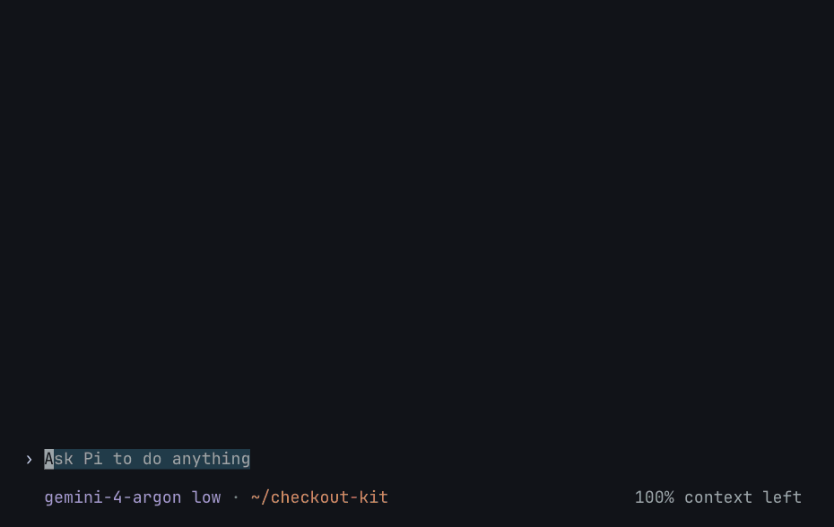
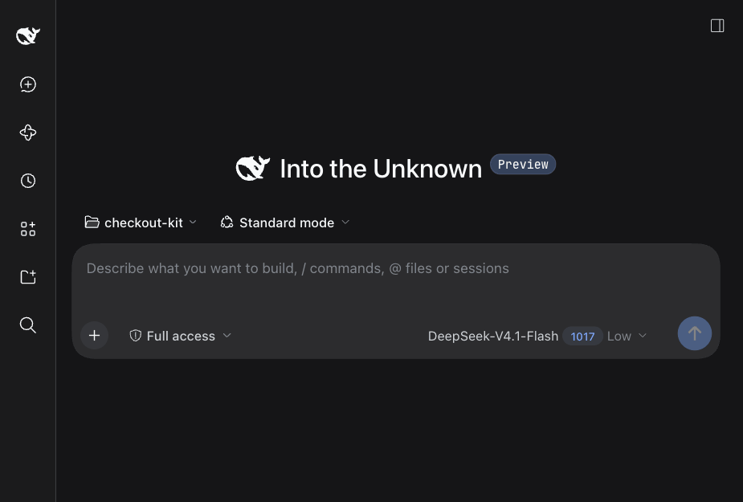

# Spine 插件：Pi 与 DeepSeek Harness

[](https://arxiv.org/abs/2610.37224) [](https://www.npmjs.com/package/@spinejit/pi-spinejit) [](https://www.npmjs.com/package/@spinejit/dsh-spinejit) [](LICENSE)

[English](README.md) | 简体中文

**让智能体的上下文与任务树自然对齐。**

长程任务天然是一棵嵌套的子任务树，但智能体的默认上下文却是一条单向堆积的扁平日志。**Spine** 将整个执行过程统一纳入持久化工作树（**`SpineTree`**，作为贯穿全局的结构主干）管理：智能体在推理时显式开启、切换和闭合本地子任务（`Open`、`Close`、`Next`），并在需要并行分治时委派子树（`Spawn`）；每次调用模型前，运行时根据 `SpineTree` 即时编译出最小有效上下文——完整保留当前活跃步骤，将已完成的子任务自动折叠为其返回结论。

在 Spine 论文（[arXiv:2610.37224](https://arxiv.org/abs/2610.37224)）中，接入 Spine 后 Pi 在 **SWE-Milestone** 上搭配 `Gemini 3.8 Flash` 与开源模型 `Qwen 3.8 27B` 分别取得 **9.5%** 与 **17.5%** 的得分提升；搭配 `Gemini 3.8 Flash` 时单次平均输入减少 **67.8%**，总成本降低 **45.4%**。

## 核心特性

- **工作树统一管理。** 本地串行子任务（`Open / Close / Next`）与并行子智能体委派（`Spawn`）统一在同一棵 `SpineTree` 下协同管理，省去串行步骤上的跨会话调度开销。
- **即时收起，无需额外摘要轮次。** 子任务结项时直接由智能体趁上下文清晰当场提交结论并收缩历史，原始探索过程完整归档在树中可随时查阅。
- **前序上下文不变，缓存持续命中。** 最内层已完成的步骤天然在上下文末尾闭合替换，前序父任务上下文保持逐字节不变，持续复用前缀缓存。
- **跨平台可移植核心。** 底层基于统一的 Rust/WASM 运行时 SDK（`@spinejit/spine-sdk`），与 [SpineCodex](https://github.com/GhabiX/SpineCodex) 共享一致的核心语义。

## 安装与使用

### 1. Spine for Pi（`@spinejit/pi-spinejit`）

```bash
pi install npm:@spinejit/pi-spinejit

# 推荐搭配：紧凑终端过程树插件（支持 regular 与 fullscreen 双模式）
pi install npm:@spinejit/pi-compact-tree
```

安装后启动 Pi 即可自动按工作树推进任务。输入框上方实时展示当前子任务树进度（`◉` 进行中，`✓` 已完成）；随时输入 `/spine-tree` 即可浏览整棵任务树并查看任意节点的记忆，不会打断当前会话。详见 [packages/plugin](packages/plugin/README.md)。

> 若从旧包名 `@spinejit/spine-plugin` 升级，请先执行 `pi remove npm:@spinejit/spine-plugin`。

<details>
<summary>点击查看 Spine for Pi 实机演示动图（任务树流转与 /spine-tree 记忆浏览）</summary>

<br />



</details>

### 2. Spine for DeepSeek Harness（`@spinejit/dsh-spinejit`）

将插件添加至 DSH 的 `web` 或 `desktop` profile 即可（插件会自动接管上下文生命周期，关闭默认的扁平压缩与输出裁剪）：

```bash
# DSH Web 端
dsh plugin --profile web add @spinejit/dsh-spinejit
dsh web

# DSH macOS 桌面端（安装后重启一次 DeepSeek Harness.app 并新建对话即可生效）
"/Applications/DeepSeek Harness.app/Contents/Resources/runtime/cli/bin/dsh" plugin --profile desktop add @spinejit/dsh-spinejit
```

任务树会在 DSH Web / Desktop 客户端输入栏上方以及 `dsh-tui` 终端提示符上方实时渲染。详见 [packages/dsh](packages/dsh/README.md)。

<details>
<summary>点击查看 Spine for DeepSeek Harness 实机演示动图</summary>

<br />



</details>

## 开源生态与配套插件

- **[SpineCodex](https://github.com/GhabiX/SpineCodex)** —— 内置 Spine 的开源 OpenAI Codex 发行版（`npm install -g @spinejit/spine-codex@latest`）。
- **配套 Pi 插件系列**：
  - [`@spinejit/pi-compact-tree`](https://github.com/GhabiX/pi-compact-tree) —— Pi 终端紧凑过程树视图（支持 `regular` 与 `fullscreen` 双模式）。
  - [`@spinejit/pi-background-job`](https://github.com/GhabiX/pi-background-job) —— 后台任务与日志监听（进程退出或命中日志自动唤醒智能体）。
  - [`@spinejit/pi-btw-cached`](https://github.com/GhabiX/pi-btw-cached) —— 复用主会话前缀缓存的 `/btw` 旁路提问，不污染主历史。
  - [`@spinejit/pi-timeout-policy`](https://github.com/GhabiX/pi-timeout-policy) —— 统一管理 `bash`、`grep`、`find` 前台工具超时策略。

源码结构与设计说明见 [doc/DESIGN.md](doc/DESIGN.md)。采用 [Apache-2.0](LICENSE) 许可证。

## 引用

```bibtex
@misc{xiang2026spine,
  title         = {Spine: Compiling Subtask Trees into Structured Context for Long-Horizon Coding Agents},
  author        = {Jiahong Xiang and Kunqiu Chen and Lingming Zhang and Yuqun Zhang},
  year          = {2026},
  eprint        = {2610.37224},
  archivePrefix = {arXiv},
  primaryClass  = {cs.SE},
  url           = {https://arxiv.org/abs/2610.37224}
}
```
