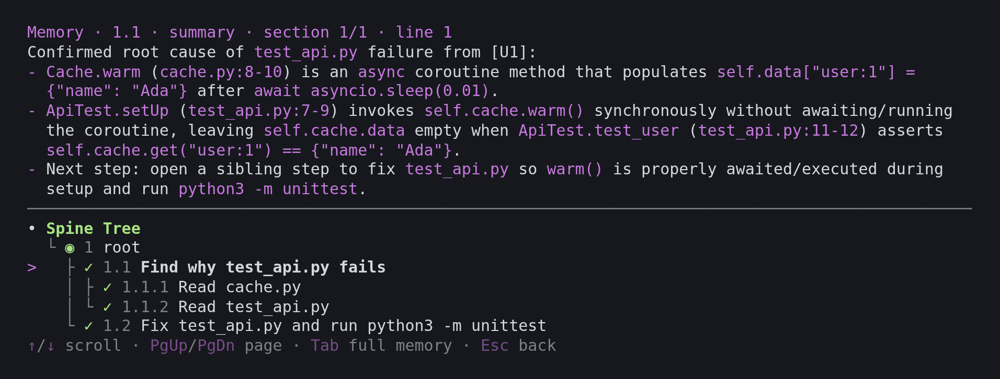

# Spine for Pi

[](https://www.npmjs.com/package/@spinejit/pi-spinejit) [](LICENSE)

[English](README.md) | 中文

**让 agent 的上下文与任务树对齐。**

长程任务本质是一棵子任务树，但 agent 的上下文却是一条扁平日志：做完的工作、走过的弯路和当前步骤全堆在同一条流里，agent 只能靠猜来分辨每段工作的起止边界。Spine 让上下文跟着任务树走。agent 开启子任务时声明目标，结束时写入记忆；Spine 会完整保留当前子任务，并将已完成的子任务自动折叠为对应的记忆。



更少上下文，更好效果：在 Spine 论文（[arXiv:2610.37224](https://arxiv.org/abs/2610.37224)）中，搭载 Spine 的 Pi 在 SWE-Milestone 上的得分比原版 Pi 高 9.5–17.5%；搭配 Gemini 3.8 Flash 时，成本还低 45%。

## 核心特性

- **边界与状态显式可见。** 每个子任务都有明确的目标、起点和终点。agent 随时能看到上层目标、当前所处步骤，以及已完成步骤留下的结论。
- **全程自动管理。** 步骤一结束，上下文就随之收缩，不用另跑一轮总结。记忆由 agent 趁还清楚重点时当场写下。
- **对话完整保留，缓存持续命中。** 你的消息与 agent 的回复都会保留，当前步骤之前的所有内容保持逐字节不变。
- **子树并行执行。** `spine_spawn` 把一棵子树交给子 agent 去做，结果回到父 agent 的树上。

## 安装

```bash
pi install npm:@spinejit/pi-spinejit
```

装好即用：启动 Pi 1.1.0，agent 就会自动按步骤推进工作。输入框上方的树实时显示当前位置；输入 `/spine-tree` 可浏览整棵树并查看任意步骤的记忆。详见 [packages/plugin](packages/plugin/README.md)。

从 `@spinejit/spine-plugin` 升级：请先运行 `pi remove npm:@spinejit/spine-plugin`。

## 相关项目

- **Codex 用户？** [SpineCodex](https://github.com/GhabiX/SpineCodex) 是内置了 Spine 的 Codex。
- **DeepSeek Harness：** 插件即将上线，见 [packages/dsh](packages/dsh/README.md)。
- 我们的更多 Pi 插件：[pi-background-job](https://github.com/GhabiX/pi-background-job)（完成后唤醒 agent 的后台任务）、[pi-btw-cached](https://github.com/GhabiX/pi-btw-cached)（复用同一缓存的 `/btw` 旁路提问）、[pi-compact-tree](https://github.com/GhabiX/pi-compact-tree)（紧凑的终端树视图）、[pi-timeout-policy](https://github.com/GhabiX/pi-timeout-policy)（统一管理所有工具的超时策略）。

源码构建与设计文档：[doc/DESIGN.md](doc/DESIGN.md)。Apache-2.0。

<details><summary>引用</summary>

```bibtex
@misc{xiang2026spine,
  title         = {Spine: Compiling Subtask Trees into Structured Context for Long-Horizon Coding Agents},
  author        = {Jiahong Xiang and Kunqiu Chen and Lingming Zhang and Yuqun Zhang},
  year          = {2026},
  eprint        = {2610.37224},
  archivePrefix = {arXiv}
}
```

</details>
